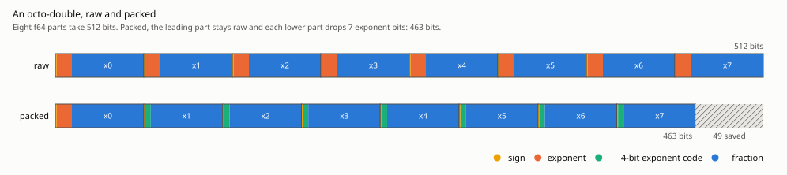
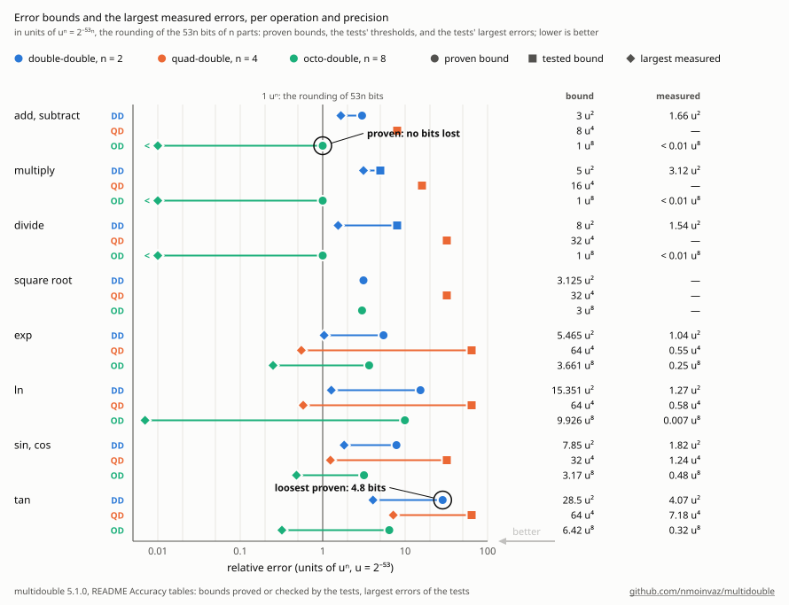
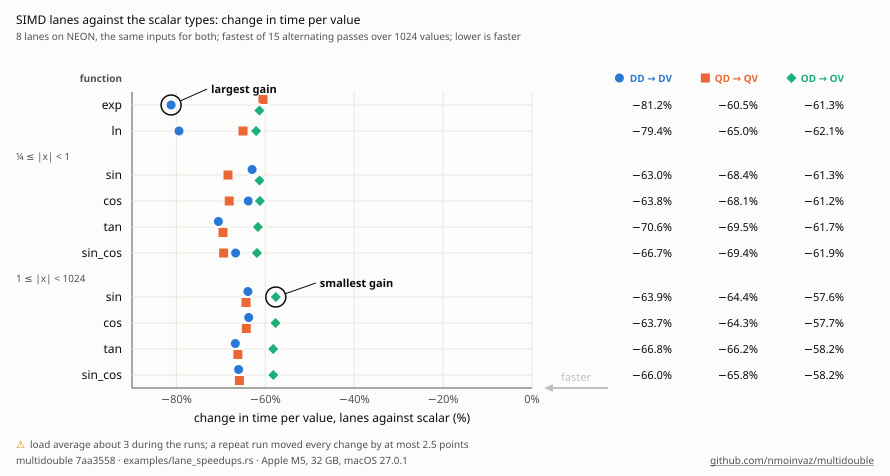
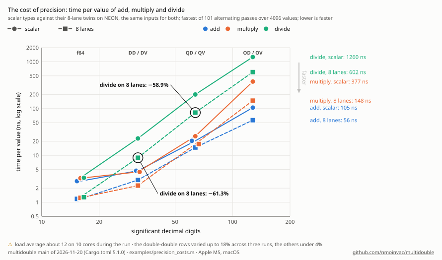

# multidouble

[](https://github.com/nmoinvaz/multidouble/actions/workflows/build.yml)
[](https://github.com/nmoinvaz/multidouble/actions/workflows/lint.yml)
[](https://codecov.io/gh/nmoinvaz/multidouble)

Double-double, quad-double and octo-double floating-point arithmetic for Rust, scalar and on 8-lane SIMD vectors, with
**bitwise the same results on AVX-512, AVX2, SSE2, NEON and portable builds**. It also has forward-mode dual numbers,
truncated power series and dense LU factorizations in all three precisions.

A double-double is an unevaluated sum `hi + lo` of two `f64`, about 32 significant digits. A quad-double is a sum of four,
about 64 digits, and an octo-double a sum of eight, about 126 digits. All are built from error-free transformations
(two-sum, FMA two-product), so they run at hardware speed, with no allocation and no arbitrary-precision library.

The octo-double add, multiply, divide and square root have proven error bounds. The paper [Error bounds for quad-double
style arithmetic on floating-point expansions of any length](paper/expansion-error-bounds.pdf) proves them for the same
algorithms at any number of parts, and shows that simple inputs reach the bounds of the add, multiply and divide.

## Types

### Numbers

| Type | What it is |
|---|---|
| `v8::V8` | 8 `f64` lanes: one AVX-512 register, two AVX2 registers, four SSE2 or NEON registers, or a plain array, with fused multiply-add throughout |
| `dd::DD`, `dv::DV` | double-double, scalar and on 8 lanes |
| `qd::QD`, `qv::QV` | quad-double, scalar and on 8 lanes, with exact decimal parsing and printing |
| `od::OD`, `ov::OV` | octo-double, scalar and on 8 lanes, with exact decimal parsing and printing: the quad-double algorithms carried to eight parts and written once for both |
| `dv::DDotAcc`, `qd::QdAcc`, `qv::QDotAcc`, `od::OdAcc`, `ov::ODotAcc` | accumulators for sums of products |

The lanes give the scalar type's bits on every backend. The scalar types have `sqrt`, `recip`, `powi`, `exp`, `ln` (also
on the lanes, NaNs included), and `sin`, `cos`, `tan` and `sin_cos` for arguments whose leading part is at most 2⁵² in
magnitude, reduced by π/2 to 1216 bits with the bits of exact integer arithmetic. The lanes have `sin`, `cos`, `tan` and
`sin_cos` too, with the scalar results' bits, NaNs included, and every type has `mul_pwr2`, a scaling by a power of two
that is exact barring overflow and underflow. Two operations trade accuracy for speed. `DD::fast_div` divides with two
divisions instead of three, within a proven 15 u² + 56 u³ barring underflow and overflow, and `OD::sloppy_mul` takes
about 1/1.35 of the time of `*` and gives up 7 to 9 of the 424 bits. An octo-double meets a double-double through
`OD::mul_dd`, `OD::add_dd` and `OdAcc::add_prod_dd`, which skip the zero parts' products and give the promoted
operation's bits, a NaN's sign and payload aside. `DD::new`, `QD::new` and `OD::new` (and `OV::new` on each lane) take
parts in any order and return their exact sum, largest part first, each part at most the ulp of the one before.
`DD::recip_int(k)`, `QD::recip_int(k)` and `OD::recip_int(k)` are 1/k, and `from_ratio(p, q)` is p/q, rounded to the
type's parts by exact integer arithmetic (`recip::ratio_parts`): constants that a precision-generic series needs in its
own rounding, where `DD::ONE / k` widened to quad- or octo-double keeps a 2^-106 error. The lanes have `recip_int` and
`mul_recip(k)`. The API documentation lists the rest, such as division by a shared divisor and conversion to arrays of
parts.

### Packed storage

| Type | What it is |
|---|---|
| `pack::PackedDD`, `pack::PackedQD`, `pack::PackedOD` | values packed in 121, 235 and 463 bits instead of 128, 256 and 512, restored bit for bit |

A lower part keeps its sign and fraction but only a 4-bit code for its exponent, which in a renormalized value lies 53
or more binary places below the part above it. Values are stored in blocks of 8, so `get(i)` reads any one of them alone
and `unpack_into` and `dot` decode 8 at a time with SIMD. A value whose parts do not fit the codes, under 0.5% of the
octo-double arithmetic's results in the tests, keeps its lower parts raw in a side table. `words` and `side` give the
storage, and `from_raw` checks and restores it.



[docs/pack.md](docs/pack.md) describes the format with diagrams, its size against general compressors, and its speed.

### Derivatives and power series

| Type | What it is |
|---|---|
| `dual::Du`, `dual::Dtn<N>` | a double-double value with a double-double tangent, or with N `f64` tangents |
| `dual::Fu`, `dual::Fun<N>` | the `f64` versions |
| `dual::Qu`, `dual::Ou` | a quad-double value with a quad-double tangent, an octo-double value with an octo-double tangent |
| `dual::Oun<N>` | an octo-double value with N octo-double tangents, each bit for bit the tangent of an `Ou` evaluation |
| `dual::Dc` | a double-double value with a complex tangent |
| `jet::Jet<N>`, `jet::QJet<N>`, `jet::OJet<N>` | a truncated power series in one variable, with N coefficients in double-double, quad-double or octo-double |
| `dual::F8` | 8 lanes of plain `f64` values, the cheapest lane type |
| `dual::Counted<L>` | any lane type with every operation counted by kind |

All of them, and `OV`, are lanes behind the `dual::Lane` trait. A computation written once over the trait gives values,
derivatives, or its own Taylor coefficients in a parameter entered as `Lane::var`, the right-hand sides of a high-order
Taylor continuation. The quad-double and octo-double jets keep the coefficients accurate where cancellation in the
computation amplifies double-double rounding. `Counted<L>` returns L's results bit for bit and counts every operation on
the thread that runs it (`dual::take_counts`), so counting a whole computation takes running it on one thread.

The dual numbers give a derivative to within the precision's own rounding, with no step to choose, where central
differences at their best step lose about a third of the digits:



### Fields and linear algebra

| Type | What it is |
|---|---|
| `field::Fl<T, B>` | 8 B values of a lane type as B lane vectors: the arithmetic of power-series methods, for every lane type |
| `field::cs`, `field::cs_range`, `field::cs_w`, `field::horner` | Cauchy products and Horner evaluation, also in place, one lane vector or one coefficient at a time, and on threads, all with the same bits |
| `field::DMat` | a constant double-double matrix applied to a field |
| `field::FieldSolve` | solves with a `DDLu`, refined in the lane type, and a jet's system order by order |
| `field::TangentTail` | ends a series once its tangent terms have stayed small for a run of orders |
| `linalg::DDLu` | dense LU with partial pivoting in double-double, blocked in `f64`: solves, transpose solves, solves refined to quad-double, Gram matrices, and the sign and ln\|det\| |
| `linalg::clu_logdet`, `linalg::clu_pivots` | ln\|det\|, arg det and the pivots of a complex double-double matrix |
| `linalg::QDLu`, `linalg::ODLu` | dense LU in quad-double and octo-double on 8-row lanes, for systems too ill-conditioned for the precision below (an `ODLu` solve errs by about cond(A) 2⁻⁴¹⁸); `QDLu` also gives the sign and ln\|det\| |
| `linalg::lu_rect_f64`, `linalg::StaircaseLu` | the `f64` LU of a block of columns, and of a staircase system with one global parameter, as multiple shooting gives |

On Hilbert matrices, whose condition number grows like e^(3.5 n), the solves keep a correct digit up to n = 12 in
`f64`, 22 in double-double, 44 in quad-double and 87 in octo-double:



### Series products

| Type | What it is |
|---|---|
| `series::mullow`, `series::mullow_naive` | the truncated product of two series of `DV`, `QV` or `OV` lanes, by block scaling and integer convolution, accurate to the precision relative to the sum of the terms' magnitudes; and the same product term by term |
| `series::Relaxed` | the product of two series of fields whose coefficients become known one order at a time, as in a recurrence solved order by order |
| `dual::Lane::block_mul`, `dual::Lane::BLOCK_MIN` | a square block of such a product, by `mullow` on `DV`, `QV`, `OV`, `Du`, `Qu` and `Ou` and term by term on the other lanes, and the side from which `mullow` is the faster |

`mullow` scales each series by a power of two per index so that its coefficients have about one size, cuts it into
blocks whose coefficients lie within a few dozen bits of each other, writes each block's coefficients as integers of
16-bit digits, and multiplies the integers by floating-point FFTs, whose results are rounded to integers. The
rounding gives the exact products if the transforms err by less than 1/2, which is not proven; each value is checked
to lie within 1/4 of an integer, and a pair that fails is formed term by term. This is van der Hoeven's stable fast
multiplication [[8]](#ref-vdh08) with the blocks of Arb [[9]](#ref-arb17). Its results are the products' to the
precision's rounding, but not bit for bit the sums of their terms.

`Relaxed` forms the products of earlier coefficients in squares of side 2^p, each once its coefficients are known and
before its first output is needed, and sums the terms with a recent coefficient directly when a coefficient is read: the
relaxed multiplication of van der Hoeven [[10]](#ref-vdh02). To order n it forms about 2n/s squares of each side s from
`BLOCK_MIN` up and about 2 `BLOCK_MIN` direct terms per order, where the sums term by term take n²/2 terms. On lanes
without fast squares its sums are bit for bit the Cauchy sums of `field::cs_range`.

`examples/series_squares.rs` times a square of each side both ways on one thread. On an Apple M5, `mullow` is the faster
from side 512 in double-double, 64 in quad-double and 16 in octo-double, and at side 4096 it takes about 1/5, 1/30 and
1/200 of the time of the terms one by one.

### Generic code

| Type | What it is |
|---|---|
| `precision::Precision`, `precision::Double`, `precision::Quad`, `precision::Octo` | one trait over double-double, quad-double and octo-double |
| `exact` | exact dyadic and decimal arithmetic, the reference the tests compare against |

`Precision` gathers one precision's scalar, lane, dual, jet and LU types, and the operations whose names or arity
differ between them (`new`, `load_field`, `coef`, `field_dual`, `lu_factor`, `dot`, ...), each delegating to the
precision's own. Code written once over `Precision` gives bitwise the results of the code written for one precision.

## Installation

Add the crate from [crates.io](https://crates.io/crates/multidouble):

```sh
cargo add multidouble
```

or as a dependency in `Cargo.toml`:

```toml
[dependencies]
multidouble = "6.0"
```

It needs Rust 1.89 or later, the version in which the AVX-512 intrinsics became stable.

## Usage

```rust
use multidouble::dd::DD;
use multidouble::native::DV;
use multidouble::qd::QD;

// double-double: about 32 digits
let third = DD::from_f64(1.0) / DD::from_f64(3.0);

// quad-double: about 64 digits, with exact decimal input and output
let sqrt2: QD = "1.414213562373095048801688724209698078569671875376948073176679737990732478"
    .parse()
    .unwrap();
println!("{}", (sqrt2 * sqrt2).to_sci(64));

// 8 double-double values at once, each lane bitwise equal to the scalar result
let x = DV::load(&[1.0, 2.0, 3.0, 4.0, 5.0, 6.0, 7.0, 8.0], &[0.0; 8]);
let y = x * x + DV::splat(third);
assert_eq!(y.lane(2), DD::from_f64(9.0) + third);
```

The SIMD backend is the best one the CPU has, detected at run time:

| Backend | Chosen when | Registers |
|---|---|---|
| `avx512` | the x86-64 CPU has AVX-512F, AVX2 and FMA | one zmm |
| `avx2` | the x86-64 CPU has AVX2 and FMA | two ymm |
| `sse2` | any other x86 or x86-64 CPU; SSE2 has no fused multiply-add, so that one operation runs per lane through `f64::mul_add` | four xmm |
| `neon` | aarch64 | four NEON |
| `portable` | every other target, or any target with the cargo feature `portable` | a plain array |

`linalg` picks it by itself. Code of your own, written once over the backend `S: Simd`, runs on it through
`simd::dispatch`:

```rust
use multidouble::dd::DD;
use multidouble::dv::{DDotAcc, DV};
use multidouble::simd::{self, Kernel, Simd};

/// the sum of squares of the double-doubles (hi, lo), 8 lanes at a time
struct SumSq<'a>(&'a [f64], &'a [f64]);

impl Kernel for SumSq<'_> {
    type Output = DD;
    // inlined into the backend's instruction set, so that the lane operations become its instructions
    #[inline(always)]
    fn run<S: Simd>(self) -> DD {
        let mut acc = DDotAcc::<S>::zero();
        for (h, l) in self.0.chunks_exact(8).zip(self.1.chunks_exact(8)) {
            let x = DV::load(h, l);
            acc = acc.add_prod(x, x);
        }
        let v = acc.finish();
        (0..8).fold(DD::ZERO, |s, j| s + v.lane(j))
    }
}

let (hi, lo) = (vec![1.5; 64], vec![0.0; 64]);
assert_eq!(simd::dispatch(SumSq(&hi, &lo)).to_f64(), 144.0);
println!("ran on {}", simd::isa());
```

Inside `run`, loop over lanes with plain `for` loops. An adapter such as `fold` runs the loop body inside a std
function, which the compiler may keep out of line and compile without the backend's instructions, so that every lane
operation becomes a call.

The aliases in `native` (`native::DV`, `native::QV`, ...) are the lane types on the backend the build's target
features select at compile time, for code that does not dispatch (`RUSTFLAGS="-C target-cpu=native"` makes that the
best one too). Results are the same on every backend; only the speed changes.

The cargo feature `f128` adds conversions between `f128` and `DD` and `QD`. It needs nightly Rust, as `f128` is
unstable. `QD::from_f128` is exact, `DD::from_f128` rounds to the nearest parts, and both `to_f128` are correctly
rounded.

## Python

[`python/`](python/README.md) is a Python package of the same arithmetic on numpy arrays: elementwise double-double add,
subtract, multiply and divide on (hi, lo) array pairs on the best backend the CPU has, double-double, quad-double and
octo-double LU solves (`od_solve` takes eight part arrays), the sign and ln|det| of a real matrix in double-double and
quad-double (`dd_logdet`, `qd_logdet`), quad-double and octo-double arrays plus a double-double one or a multiple of
another (`qd_add_dd`, `qd_axpy`, `od_add_dd`, `od_axpy`), and numpy versions of the error-free transformations (`pip
install ./python`, which builds it with maturin).

## Accuracy

Every operation is tested against exact arithmetic (`exact`), which shares no code with the algorithms. With u = 2⁻⁵³,
the parts of an n-part type hold 53n significand bits, and the natural target is an error of uⁿ times the result, the
rounding error of a format with 53n bits. The table gives each operation's error bound in those units, with the bits it
gives up in parentheses.

| Operation | double-double (106 bits) | quad-double (212 bits) | octo-double (424 bits) |
|---|---|---|---|
| add, subtract | 3 u² (1.6), proven | 8 u⁴ (3) | u⁸ (0), proven |
| multiply | 5 u² (2.3) | 16 u⁴ (4) | u⁸ (0), proven |
| divide | 8 u² (3) | 32 u⁴ (5) | u⁸ (0), proven |
| square root | 25/8 u² (1.6), proven | 32 u⁴ (5) | 3 u⁸ (1.6), proven |
| exp | 5.465 u² (2.5), proven | 64 u⁴ (6) | 3.661 u⁸ (1.9), proven |
| ln | 15.351 u² (3.9), proven | 64 u⁴ (6) | 9.926 u⁸ (3.3), proven |
| sin, cos | 7.85 u² (3.0), proven | 32 u⁴ (5) | 3.17 u⁸ (1.7), proven |
| tan | 28.5 u² (4.8), proven | 64 u⁴ (6) | 6.42 u⁸ (2.7), proven |

A proven bound holds for every input that meets its hypotheses: for the octo-double, parts on the ladder |xᵢ| ≤
(2u)ⁱ|x₀| and no underflow in the run, and for the double-double, a double-word. The double-double add's bound is
Theorem 3.1 of Joldes, Muller and Popescu (2017) [[1]](#ref-jmp17), `fast_div`'s is their Theorem 7.1, which Muller and
Rideau (2022) [[2]](#ref-mr22) proved formally, the square root's is Theorem 3.5 of Lefèvre, Louvet, Muller, Picot and
Rideau (2023) [[3]](#ref-llmpr23), and the elementary functions' follow from the published bounds of the double-word
operations they use. The octo-double bounds are proved in [the paper](paper/expansion-error-bounds.pdf), where the add,
multiply, divide and square root each have a second term at most 2⁻¹⁵ of the first. The quad-double bounds are the
thresholds the tests check, for the default `+`, `*` and `/`; `ieee_add`, `accurate_mul` and `accurate_div` keep 8 u⁴, 8
u⁴ and 16 u⁴.

The elementary functions' bounds also have a range and an absolute term. The absolute term exceeds the relative one only
for exp below eˣ = 2⁻⁶⁴⁸ (2⁻⁹⁶⁹ for the double-double) and for ln where |ln x| < 2⁻⁸⁸ (2⁻⁹⁶⁸), and the ln bound is
relative to |ln x|.

| Function | Range | Absolute term, double-double | Absolute term, octo-double |
|---|---|---|---|
| sin, cos | \|x₀\| ≤ 2⁵², NaN beyond | 5\|k\|·2⁻¹²¹⁷ | 5\|k\|·2⁻¹²¹⁷ |
| tan | \|x₀\| ≤ 2⁵², NaN beyond | 5\|k\|·2⁻¹²¹⁷/\|sin x cos x\|, relative | 5\|k\|·2⁻¹²¹⁷/\|sin x cos x\|, relative |
| exp | eˣ below f64::MAX + ulp/2, +inf above | 2·2⁻¹⁰⁷⁴ | 8·2⁻¹⁰⁷⁴ |
| ln | every positive finite x | 2⁻¹⁰⁷¹ | 2⁻⁵⁰⁹ |

Here k is the multiple of π/2 that the reduction removes, so 5|k|·2⁻¹²¹⁷ < 2⁻¹¹⁶³. The reduction is exact up to π/2's
1216 fraction bits, which come from Machin's formula [[4]](#ref-machin), π/4 = 4 arctan(1/5) − arctan(1/239), checked
against Gauss's, π/4 = 12 arctan(1/18) + 8 arctan(1/57) − 5 arctan(1/239), so the bounds hold next to the multiples of
π/2 too. exp reduces by k ln 2, with ln 2 split into a head whose multiples are exact and a tail, as Cody and Waite do
[[5]](#ref-cw80), and squares as t ← 2t + t², as the QD library's exp does; ln takes one Newton step on exp, as its log
does [[6]](#ref-qd), from a binary64 logarithm of its own, proved within 5.915 u, so no bound rests on the platform's
`ln`. The functions scale small arguments by powers of two so that no product underflows, unless a part of x lies far
below the ladder. The paper proves the octo-double bounds in Theorems 35, 40 and 42.

The largest errors the tests measured on generated inputs, against exact arithmetic or a reference of 1700 to 2200 bits:

| Operation | double-double | quad-double | octo-double |
|---|---|---|---|
| add, multiply, divide | 1.66, 3.12, 1.54 u² | | below 0.01 u⁸ |
| exp, ln | 1.04, 1.27 u² | 0.55, 0.58 u⁴ | 0.25, 0.0070 u⁸ |
| sin and cos, tan | 1.82, 4.07 u² | 1.24, 7.18 u⁴ | 0.48, 0.32 u⁸ |

The exp and ln row is from ten times the tests' default inputs, and the other rows from the default run. The
double-double add is measured relative to the result, the quad-double `+` and the octo-double add's second term against
|a| + |b|, and the double-double divide on the residual of its quotient. The octo-double add, multiply and divide reach
their bounds on the paper's worst-case inputs, its constructed inputs make the square root, sin, cos, tan, exp and ln
err by about u⁸, and random inputs stay far inside. On generated inputs just below 2⁻²¹², the octo-double sin, cos and
tan reach 0.16, 0.48 and 0.32 u⁸, the early return's x²/6, x²/2 and x²/3, and they stay below 0.01 u⁸ elsewhere.

The octo-double add, multiply and divide give up none of their 424 bits, and the loosest proven bound, the
double-double tan's, gives up 4.8 of 106:



The quad-double types use the QD library's algorithms (Hida, Li and Bailey, ARITH-15, 2001) [[7]](#ref-hlb01) with three
repairs, two to the accurate add and one to the square root, which now scales its argument by a power of four.
`OD::sloppy_mul` errs by at most 2³¹·⁹³ u⁸|a₀b₀| for operands on the ladder (the paper's Theorem 30), where `*` errs by
u⁸; random operands give at most 98 u⁸|a₀b₀| and a hill climb 582 u⁸|a₀b₀|.

Two-sum, quick-two-sum and two-product are exact. Octo-double dot products of n terms are checked against the
accumulator's bound, (|Z| + cₙ Σ|aᵢbᵢ|) u⁸ with cₙ below 1 up to 50 terms (proved in the paper); the second term grows
like (nu)⁹ Σ|aᵢbᵢ|, and 2048 constructed terms reach 2²³·⁸ u⁸|Z|. Full precision needs every part to be a normal `f64`,
so octo-double values above about 2⁻⁶⁰⁰; near underflow the tests allow an absolute 16×2⁻¹⁰⁷⁴.

| Type | Accuracy |
|---|---|
| `ODLu` | about 10⁻¹³³ cond(A) for condition numbers up to 10³⁰, 2⁻²²⁰ times the quad-double LU's error |
| `OJet` | coefficients within 10⁻¹²³ of the sum of their terms' magnitudes, where the quad-double jet errs by 2×10⁻⁶⁴; its order-by-order solve reaches planted solutions within 10⁻¹²⁰ in four refinement steps |
| `Ou` | derivatives within 10⁻¹²³, and its value is `OV`'s bit for bit |

Every check can fail. The feature `mutate` breaks steps of the quad-double and octo-double algorithms, of exp, ln, sin,
cos and tan and their lanes, of the jets, dual numbers and field sums, of the packed storage's decoders, and of the
constructors, one at a time, and the tests run with it check that each breakage fails a test. The integration tests
also feed deliberately wrong results to the same checks: a double-double add without its low parts, a wrong derivative,
a perturbed LU factor, and f128 conversions that round twice.

## Testing, coverage and benchmarks

```sh
cargo test --release                                            # SSE2 on x86, NEON on aarch64
cargo test --release --features portable                        # the plain-array backend
RUSTFLAGS="-C target-feature=+avx2,+fma" cargo test --release   # AVX2
RUSTFLAGS="-C target-cpu=native" cargo test --release           # AVX-512 where the CPU has it
cargo test --release --features mutate                          # the mutation controls
cargo +nightly test --release --features f128                   # the f128 conversions
cargo llvm-cov --features mutate                                # coverage (cargo-llvm-cov)
cargo bench --bench arith                                       # scalar against lanes; f64, double-double, quad-double, octo-double
cargo bench --bench linalg                                      # double-double LU against f64 LU, and the octo-double LU
cargo bench --bench jet                                         # OJet<24> against QJet<24>: product, sums, the jet solve
cargo test --release --test odlu bench_od_lu -- --ignored --nocapture   # the octo-double LU at n = 64, 256, 800
cargo test --release --test explog timing -- --ignored --nocapture      # exp and ln, scalar and lanes, time per value
cargo run --release --example lane_speedups > docs/lane-speedups.jsonl   # the elementary functions, scalar against lanes
cargo run --release --example precision_costs > docs/precision-costs.jsonl   # add, multiply, divide, scalar against lanes
cargo run --release --example hilbert > docs/hilbert.jsonl                   # Hilbert solves in each precision
cargo run --release --example derivatives > docs/derivatives.jsonl           # central differences against dual numbers
```

Each precision costs more than the one below it:

| Comparison | Per operation | Sums of products |
|---|---|---|
| quad-double against double-double | 8–29× | 14–17× |
| octo-double against quad-double, NEON lanes | 4–8× (add 3.7, multiply 5.3, divide 7.6) | about 14×, as its accumulator keeps the smallest partial products the quad-double one drops |

On the NEON lanes an `OJet<24>` product costs 7.6 times a `QJet<24>` one, a term of its sums 12 times, and a 24-order
solve on 32 values 8.3 times, with four refinement steps against two.

On the NEON lanes the elementary functions take 58 to 81% less time per value than on the scalar types:



Add, multiply and divide take 28 to 62% less time per value on the NEON lanes than on the scalar types:



The tests check that `V8`, `DV`, `QV` and `OV` match the scalar types bit for bit, `OJet` its scalar series `OSeries`
and `Ou` its scalar formulas, on every backend the CPU has. The NEON backend's code is also compiled on x86 against a
pure-Rust model of its intrinsics and checked there, so it is tested on every runner, not only on ARM. CI runs the whole
suite on:

- the portable, SSE2, AVX2, AVX-512 and NEON backends;
- Linux on x86-64, ARM64, ARMv7, PPC64LE, RISC-V 64 and S390X (big-endian);
- macOS on ARM64;
- Windows on x64 and x86;
- nightly Rust with the feature `f128`, on x86-64 and ARM64 Linux.

It also runs coverage, clippy on each backend, and a library check at the minimum Rust version.

## Origin

This code was written for a double-double solver of Choptuik's critical collapse in D dimensions
([choptuik-large-d](https://github.com/nmoinvaz/choptuik-large-d)). That solver needs about 30 digits and an exact
Jacobian at the speed of SIMD f64 code, and at large D, where rounding is amplified, quad-double and octo-double.

## References

1. <a id="ref-jmp17"></a>M. Joldes, J.-M. Muller, V. Popescu, "Tight and rigorous error bounds for basic building blocks
   of double-word arithmetic", ACM Trans. Math. Softw. 44(2), 2017,
   [doi:10.1145/3121432](https://doi.org/10.1145/3121432).
2. <a id="ref-mr22"></a>J.-M. Muller, L. Rideau, "Formalization of double-word arithmetic, and comments on 'Tight and
   rigorous error bounds for basic building blocks of double-word arithmetic'", ACM Trans. Math. Softw. 48(1), 2022,
   [doi:10.1145/3484514](https://doi.org/10.1145/3484514).
3. <a id="ref-llmpr23"></a>V. Lefèvre, N. Louvet, J.-M. Muller, J. Picot, L. Rideau, "Accurate calculation of Euclidean
   norms using double-word arithmetic", ACM Trans. Math. Softw. 49(1), 2023,
   [doi:10.1145/3568672](https://doi.org/10.1145/3568672).
4. <a id="ref-machin"></a>W. Jones, *Synopsis Palmariorum Matheseos*, J. Wale, London, 1706, p. 263, which gives John
   Machin's series for π.
5. <a id="ref-cw80"></a>W. J. Cody, Jr., W. Waite, *Software Manual for the Elementary Functions*, Prentice-Hall,
   Englewood Cliffs, NJ, 1980, ISBN 0-13-822064-6.
6. <a id="ref-qd"></a>Y. Hida, X. S. Li, D. H. Bailey, the QD library, `exp` and `log` in `src/dd_real.cpp` and
   `src/qd_real.cpp`, [github.com/BL-highprecision/QD](https://github.com/BL-highprecision/QD).
7. <a id="ref-hlb01"></a>Y. Hida, X. S. Li, D. H. Bailey, "Algorithms for quad-double precision floating point
   arithmetic", 15th IEEE Symposium on Computer Arithmetic (ARITH-15), 155–162, 2001,
   [doi:10.1109/ARITH.2001.930115](https://doi.org/10.1109/ARITH.2001.930115).

8. <a id="ref-vdh08"></a>J. van der Hoeven, "Making fast multiplication of polynomials numerically stable", preprint,
   Université Paris-Sud, 2008, [texmacs.org/joris/stablemult](https://www.texmacs.org/joris/stablemult/stablemult.html).
9. <a id="ref-arb17"></a>F. Johansson, "Arb: efficient arbitrary-precision midpoint-radius interval arithmetic", IEEE
   Trans. Comput. 66(8), 1281–1292, 2017, [doi:10.1109/TC.2017.2690633](https://doi.org/10.1109/TC.2017.2690633).
10. <a id="ref-vdh02"></a>J. van der Hoeven, "Relax, but don't be too lazy", J. Symbolic Comput. 34(6), 479–542, 2002,
    [doi:10.1006/jsco.2002.0562](https://doi.org/10.1006/jsco.2002.0562).

## Related crates

- [multisolver](https://github.com/nmoinvaz/multisolver) solves nonlinear systems F(z) = 0 in this crate's double-,
  quad- and octo-double precisions, by Newton's method and its variants, Levenberg-Marquardt, the asymptotic
  numerical method and the argument-principle zero count.
- [multishoot](https://github.com/nmoinvaz/multishoot) solves boundary-value problems by multiple shooting, with
  Taylor-series steps between nodes, exact Jacobians from this crate's dual numbers, and multisolver's solvers.

## License

[BSD 3-Clause](LICENSE), the license of the QD library whose quad-double algorithms `src/qd.rs` and `src/qv.rs`
follow, and `src/od.rs` carries to eight parts. QD's own notice is kept in [LICENSE-QD](LICENSE-QD).
