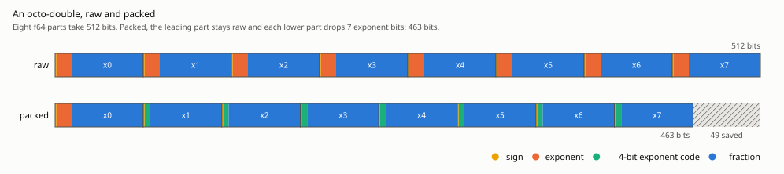
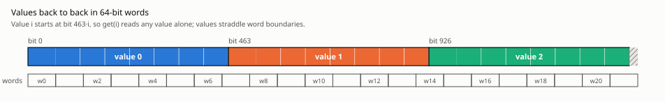

# Packed storage

`pack::PackedDD`, `PackedQD` and `PackedOD` store double-double, quad-double and octo-double values in 121, 235 and
463 bits instead of 128, 256 and 512, and give every value back bit for bit.

A multi-part value is a sum of `f64` parts, each far smaller than the one above. Every part carries its own 11-bit
exponent, but in a renormalized value each lower part sits 53 or more binary places below the part above it. So a lower
part's exponent is almost known in advance and carries about 2 bits of information. The packed format stores only that.



## One lower part

The leading part stays a raw `f64`. Each lower part keeps its sign and 52 fraction bits, and its exponent becomes a
4-bit code.


The drop is counted from the last nonzero part above, so zero parts between nonzero ones cost nothing extra.

## Values in a stream

Values sit back to back in one array of 64-bit words, so value `i` starts at bit `463 i` and `get(i)` reads it alone,
without decoding the values before it.



## The side table

A value that does not fit the codes keeps its lower parts raw in a side table. Its slot holds its leading part and the
table row.


That covers subnormal, infinite and NaN parts and unusual gaps, so every bit pattern round-trips, including −0 and NaN
payloads. In practice it is rare:

| data | values | escaped | bits per value |
|---|---|---|---|
| octo-double arithmetic results (`tests/pack.rs`) | 20,000 | 16 | 463.4 |
| octo-double Taylor coefficients of a numerical continuation | 6,921 | 7 | 463.5 |
| an octo-double solution state of the same continuation | 769 | 0 | 463.1 |

## Size against general compressors


General compressors do not see that each part's exponent follows from the one above, so on their own they save little:
lzma saves 3.2%. Blosc-style shuffling helps them, because grouping the exponent bytes of all values exposes their
repetition, and byte shuffle with lzma beats the packed format's size. Replacing each exponent by its drop below the
part above before shuffling saves the most, 13.3%. The packed format's advantage is not its size but that any value is
read alone, with no block to decompress.

The shuffles are simulated in numpy with Python's zlib and lzma, on values interleaved in memory, except the
exponent-delta row, which shuffles each part's array separately (`scripts/pack_sizes.py`).

## Speed

Packing does not make arithmetic faster: values are unpacked to `f64` parts before any operation. In memory it is much
slower than a plain copy. On 2²⁰ octo-doubles (64 MiB) on an Apple M5, from `cargo bench --bench pack`:

| operation | time per value | throughput of raw values |
|---|---|---|
| copy the raw values | 3.2 ns | 18.8 GiB/s |
| `get(i)` for every `i` | 19 ns | 3.1 GiB/s |
| `unpack` | 23 ns | 2.6 GiB/s |
| `pack` | 32 ns | 1.9 GiB/s |

So packing pays off only where values move through something slower than about 2 GiB/s: files, networks and
checkpoints. There it saves 9.6% of the bytes. The current code is scalar and reads each field bit by bit, so a bulk or
SIMD unpack could be several times faster, but the most any packing of this kind can save is about 12%.

## Use

```rust
use multidouble::od::OD;
use multidouble::pack::PackedOD;

let v: Vec<OD> = (1..=4).map(|k| OD::from_f64(1.0) / OD::from_f64(k as f64)).collect();
let p = PackedOD::pack(&v);
let third: OD = p.get(2); // bit for bit v[2]
let (words, side) = (p.words().to_vec(), p.side().to_vec()); // to store
let q = PackedOD::from_raw(v.len(), words, side).unwrap(); // checked on load
assert_eq!(q, p);
```

## Regenerating

```sh
python3 scripts/pack_graphs.py                 # the diagrams and the size chart, docs/pack-*.svg
python3 scripts/pack_sizes.py values.bin ...   # the chart's compressor sizes, from octo-doubles as 8 f64 each (numpy)
cargo bench --bench pack                       # the speed table
```
