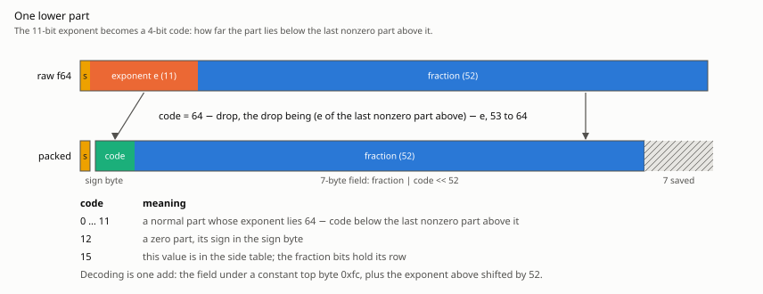
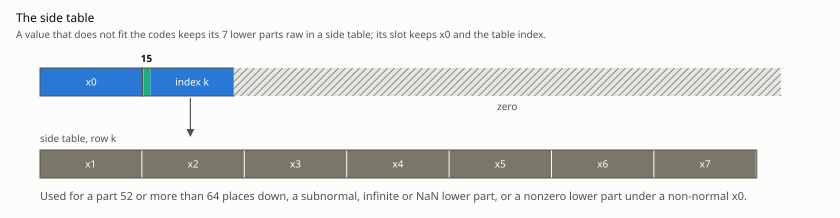
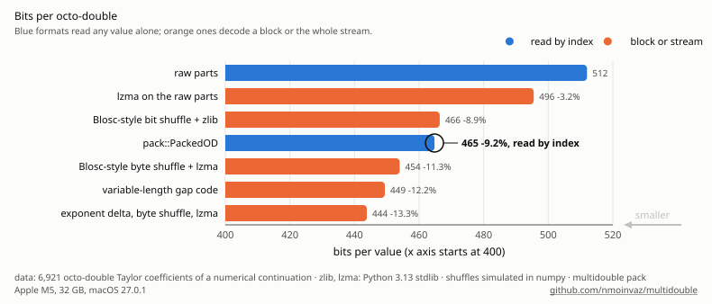

# Packed storage

`pack::PackedDD`, `PackedQD` and `PackedOD` store double-double, quad-double and octo-double values in 121, 235 and
463 bits instead of 128, 256 and 512, and give every value back bit for bit.

A multi-part value is a sum of `f64` parts, each far smaller than the one above. Every part carries its own 11-bit
exponent, but in a renormalized value each lower part sits 53 or more binary places below the part above it. So a lower
part's exponent is almost known in advance and carries about 2 bits of information. The packed format stores only that.


## One lower part

The leading part stays a raw `f64`. Each lower part keeps its sign and 52 fraction bits, and its exponent becomes a
4-bit code. The sign is stored in a byte shared by 8 values, and the code and fraction in a 7-byte field.



The drop is counted from the last nonzero part above, so zero parts between nonzero ones cost nothing extra.

## Blocks of 8

Values sit in blocks of 8, each `64 + 57 (N − 1)` bytes, so a value still takes 121, 235 or 463 bits. A block holds the
8 leading parts raw, then for each lower part the 8 values' 7-byte fields and one byte of their signs. `get(i)` reads
value `i` alone from block `i / 8`, and a SIMD decoder reads a whole block with a few byte shuffles: decoding a part is
one add, the field under a constant top byte `0xfc` plus the exponent above. `unpack_into` and `dot` decode 8 values at
a time on NEON, AVX2 or AVX-512, with bitwise the same results as plain code.


## The side table

A value that does not fit the codes keeps its lower parts raw in a side table. Its slot holds its leading part and the
table row.



That covers subnormal, infinite and NaN parts and unusual gaps, so every bit pattern round-trips, including −0 and NaN
payloads. In practice it is rare:

| data | values | escaped | bits per value |
|---|---|---|---|
| octo-double arithmetic results (`tests/pack.rs`) | 20,000 | 69 | 464.5 |
| octo-double Taylor coefficients of a numerical continuation | 6,921 | 20 | 464.8 |
| an octo-double solution state of the same continuation | 769 | 2 | 468.4 |

The state's 769 values leave 7 places of padding in their last block, which costs 4.2 bits per value.

## Size against general compressors



General compressors do not see that each part's exponent follows from the one above, so on their own they save little:
lzma saves 3.2%. Blosc-style shuffling helps them, because grouping the exponent bytes of all values exposes their
repetition, and byte shuffle with lzma beats the packed format's size. Replacing each exponent by its drop below the
part above before shuffling saves the most, 13.3%. The packed format's advantage is not its size but that any value is
read alone, with no block to decompress.

The shuffles are simulated in numpy with Python's zlib and lzma, on values interleaved in memory, except the
exponent-delta row, which shuffles each part's array separately (`scripts/pack_sizes.py`).

## Speed

Packing does not make arithmetic faster: values are unpacked to `f64` parts before any operation. In memory it is slower
than a plain copy. On 2²⁰ octo-doubles (64 MiB) on an Apple M5, from `cargo bench --bench pack`, with other work
running (load average 5 to 10), so the figures vary between runs:

| operation | time per value | throughput of raw values |
|---|---|---|
| copy the raw values | 2.5 ns | 23.9 GiB/s |
| `unpack` | 7.2 ns | 8.3 GiB/s |
| `get(i)` for every `i` | 18 ns | 3.4 GiB/s |
| `pack` | 38 ns | 1.6 GiB/s |

A double-double dot product reading packed vectors runs at about half the speed of one reading raw vectors on one core
(`cargo bench --bench pack_simd`), because the raw one is limited by arithmetic, not memory. Packing pays off where
values move through something slower than its decoding: files, networks and checkpoints, and, by estimate,
many cores sharing one memory bus. There it saves 9.6% of the bytes, and the most any packing of this kind can save is about 12%.

## Use

```rust
use multidouble::od::OD;
use multidouble::pack::PackedOD;

let v: Vec<OD> = (1..=4).map(|k| OD::from_f64(1.0) / OD::from_f64(k as f64)).collect();
let p = PackedOD::pack(&v);
let third: OD = p.get(2); // bit for bit v[2]
let (words, side) = (p.words().to_vec(), p.side().to_vec()); // to store
let q = PackedOD::from_raw(v.len(), words, side).unwrap(); // checked on load
assert_eq!(q, p);
```

## Regenerating

```sh
python3 scripts/pack_graphs.py                 # the diagrams and the size chart, docs/pack-*.svg
python3 scripts/pack_sizes.py values.bin ...   # the chart's compressor sizes, from octo-doubles as 8 f64 each (numpy)
cargo bench --bench pack                       # the speed table
cargo bench --bench pack_simd                  # bulk decoding and dot products against raw values
```
